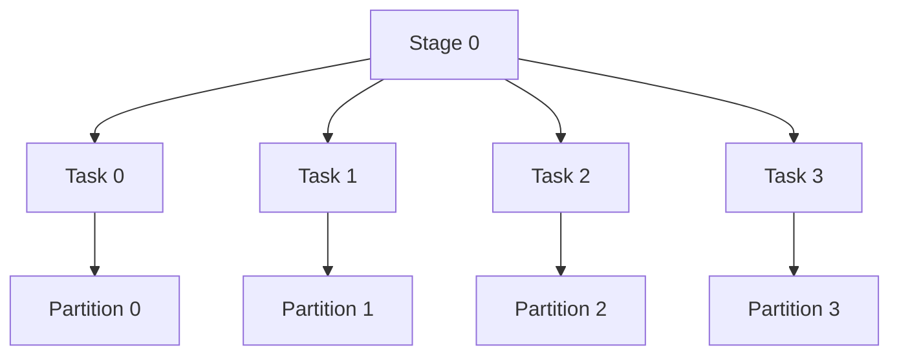
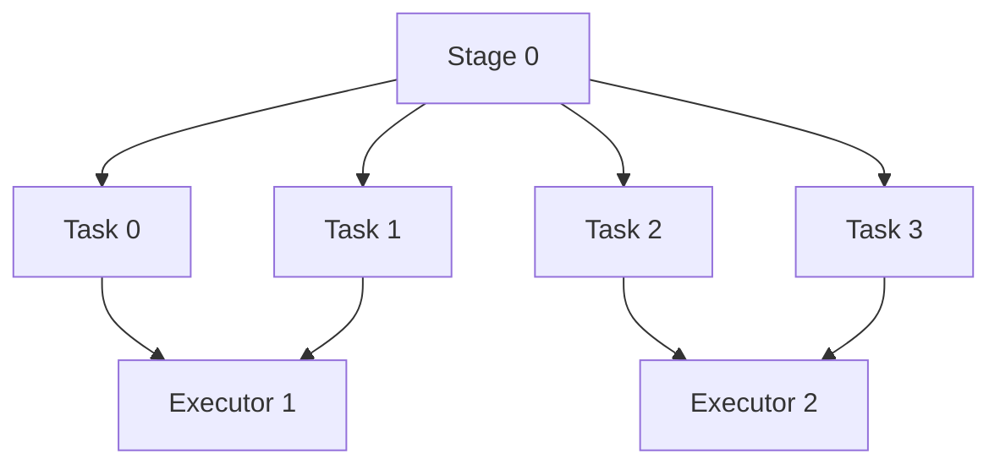

**1. Какие вкладки есть в Spark UI?**

<details>
<summary><strong>Ответ на вопрос</strong></summary>

**Spark UI** — веб-интерфейс для мониторинга выполнения Spark-приложения, анализа задач и поиска проблем с производительностью.

Основные вкладки:

| Вкладка | Назначение |
|---|---|
| **Jobs** | Показывает Spark Jobs, их статус, длительность и связанные стадии (Stages). |
| **Stages** | Детальная информация о стадиях: задачи (Tasks), время выполнения, shuffle, ошибки и распределение нагрузки. |
| **Storage** | Информация о RDD и DataFrame, сохранённых в памяти или на диске через `cache()` / `persist()`. |
| **Environment** | Конфигурация Spark-приложения, системные свойства и используемые библиотеки. |
| **Executors** | Информация об executor'ах: использование памяти, объём обработанных данных, задачи, ошибки и время работы. |
| **SQL / DataFrame** | Информация о SQL-запросах и DataFrame-операциях: физический план выполнения, стадии и метрики. |

Вкладка **SQL** отображается, когда приложение выполняет операции через Spark SQL или DataFrame API. Набор вкладок и доступные метрики зависят от версии Spark и конфигурации.

### Что важно понимать на собеседовании

- **Jobs** — смотрим, какие задания выполняются и сколько времени занимают.
- **Stages** — ищем медленные стадии и проблемы с shuffle.
- **Executors** — анализируем нагрузку, память и распределение задач между исполнителями.
- **Storage** — проверяем, какие данные закэшированы.
- **Environment** — проверяем настройки Spark.
- **SQL** — изучаем план выполнения запросов и метрики операций.

</details>

**2. Что такое Job, Stage, Task?**

<details>
<summary><strong>Ответ на вопрос</strong></summary>


# Spark Jobs, Stages и Tasks

## 1. Общая идея

Когда Spark выполняет обработку данных, он разбивает вычисления на задания и более мелкие части.

Есть три основных понятия:

- **Job** — вычислительное задание целиком.
- **Stage** — этап выполнения Job.
- **Task** — отдельная часть работы внутри Stage, обычно обрабатывающая одну партицию данных.

Связь между ними:

```text
Job — всё вычислительное задание
 ├── Stage 1 — первый этап
 │    ├── Task 1 — обработка партиции
 │    ├── Task 2 — обработка партиции
 │    └── Task 3 — обработка партиции
 │
 └── Stage 2 — второй этап
      ├── Task 1 — обработка партиции
      ├── Task 2 — обработка партиции
      └── Task 3 — обработка партиции
```

Это условная схема. В реальном приложении количество Stage и Task зависит от плана выполнения, партиций данных и операций.

## 2. Пример

Представим, что у нас есть таблица с 10 миллионами сотрудников. Нужно вычислить среднюю зарплату по каждой должности.

```python
df.groupBy("role").agg(
    avg("salary").alias("avg_salary")
).show()
```

Spark должен выполнить несколько действий:

1. Обработать исходные данные.
2. Сгруппировать данные по должностям.
3. Рассчитать среднюю зарплату.
4. Вернуть результат.

Spark организует выполнение этой работы.

### Job — что нужно сделать?

Job — вычислительное задание, которое Spark запускает, когда действие (action) требует вычислений.

В нашем примере цель — получить среднюю зарплату по должностям.

### Stage — на какие этапы разделена работа?

Stage — часть Job.

Spark разделяет Job на Stages с учётом зависимостей между операциями. Например, при группировке может потребоваться `shuffle` — обмен данными между партициями, чтобы собрать записи с одинаковыми должностями.

Shuffle часто приводит к границе между Stages.

### Task — кто обрабатывает отдельные части данных?

Task — единица работы внутри Stage. Обычно одна Task обрабатывает одну партицию данных.

Если Stage содержит четыре партиции, для его выполнения обычно потребуется четыре Tasks.

Несколько Tasks могут выполняться параллельно, если есть доступные ресурсы.

## 3. Что такое партиция?

**Партиция — часть данных, на которую Spark разделяет DataFrame для обработки.**

Например, таблица из 12 миллионов строк может быть разделена на 4 партиции по 3 миллиона строк.

Условная схема:

```text
DataFrame: 12 миллионов строк
          |
          v
  ┌───────┬───────┬───────┬───────┐
  │ Part 1│ Part 2│ Part 3│ Part 4│
  │ 3 млн │ 3 млн │ 3 млн │ 3 млн │
  └───────┴───────┴───────┴───────┘
```

Если Stage обрабатывает все четыре партиции, Spark обычно создаёт четыре Tasks — по одной на партицию.

Количество партиций не обязательно равно количеству Worker или Executor.

## 4. Где выполняются Tasks?

Tasks выполняются на Executor.

- **Master** управляет ресурсами кластера.
- **Worker** предоставляет вычислительные ресурсы.
- **Driver** управляет выполнением приложения.
- **Executor** выполняет Tasks.

Например, один Worker может запустить несколько Tasks на своих Executor, если хватает доступных ресурсов.

## 5. Как Job, Stage и Task связаны между собой?

| Термин | Что означает | Пример |
|---|---|---|
| Job | Всё вычислительное задание | Получить среднюю зарплату по должностям |
| Stage | Этап выполнения Job | Обработка данных до или после shuffle |
| Task | Часть работы внутри Stage | Обработка одной партиции |

## 6. Почему Spark создаёт Jobs?

Многие операции PySpark являются преобразованиями (transformations). Они описывают, как нужно обработать данные.

Например:

```python
filtered_df = df.filter(col("salary") > 90)
```

Само преобразование обычно не запускает вычисление результата.

Когда вызывается действие:

```python
filtered_df.show()
```

Spark запускает необходимые вычисления. Это может привести к созданию одного или нескольких Jobs.

Другие примеры действий:
- `show()`
- `count()`
- `collect()`
- `write...`

Количество Jobs не обязательно совпадает с количеством строк кода: Spark может запускать дополнительные Jobs в зависимости от операции и плана выполнения.

## 7. Где посмотреть Jobs, Stages и Tasks?

Открой Spark Application UI:

http://localhost:4040

Основные разделы:

- **Jobs** — список заданий приложения.
- **Stages** — этапы выполнения заданий.
- **Tasks** — отдельные части работы внутри Stage; их можно посмотреть в деталях соответствующего Stage.
- **Executors** — информация об исполнителях и используемых ресурсах.

Application UI обычно доступен, пока приложение работает.

## 8. Главное, что нужно запомнить

1. **Job** — вычислительное задание целиком.
2. **Stage** — этап выполнения Job.
3. **Task** — отдельная часть работы внутри Stage, обычно над одной партицией.
4. Spark может выполнять Tasks параллельно.
5. Shuffle часто разделяет выполнение на разные Stages.
6. Tasks выполняются на Executor, а Driver управляет выполнением приложения.
7. Количество Jobs, Stages и Tasks зависит от операций и плана выполнения Spark.


</details>


**3. Как Spark разбивает на партиции?**

<details>
<summary><strong>Ответ на вопрос</strong></summary>

# Apache Spark — партиции (Partitions)

## 1. Что такое партиция?

**Партиция (Partition)** — это логическая часть данных, которую Spark обрабатывает независимо от других частей.

Партиции позволяют распределять вычисления между executors и выполнять задачи параллельно.

Важно различать:
- **Partition** — часть данных.
- **Task** — задача, обрабатывающая одну партицию на конкретной стадии (`Stage`).
- **Executor** — процесс, выполняющий задачи.
- **CPU core** — вычислительный ресурс, позволяющий выполнять задачи параллельно.
- **Driver** — планирует вычисления и координирует работу приложения.

## 2. Как Spark формирует партиции?

При чтении данных Spark формирует входные партиции автоматически. Их количество зависит от:
- размера и количества файлов;
- формата данных и возможности разделить файл на части;
- настроек Spark;
- особенностей источника данных.

Например:

```python
df = spark.read.parquet("/data/salaries")

# Количество партиций
print(df.rdd.getNumPartitions())
```

Один большой файл может быть прочитан несколькими партициями, а несколько маленьких файлов могут объединяться в одну партицию.

**Количество партиций не определяется автоматически количеством CPU-ядер.** Число ядер влияет на количество задач, которые могут выполняться одновременно, а число партиций определяет, сколько частей данных предстоит обработать.

## 3. Как связаны Partitions, Tasks и Executors?

Допустим:
- создано 8 партиций;
- запущены 2 executors;
- каждому executor выделено по 2 CPU-ядра для задач Spark.

```text
                  Driver
                    |
              8 Tasks на Stage
                    |
          +---------+---------+
          |                   |
          v                   v
     Executor 1           Executor 2
     2 CPU cores          2 CPU cores
          |                   |
     Task 0, Task 1      Task 2, Task 3
          |                   |
          +---------+---------+
                    |
           4 Tasks одновременно

           После завершения:
     Executor 1           Executor 2
     Task 4, Task 5      Task 6, Task 7
```

В этом примере одновременно выполняются до четырёх задач, если ресурсы доступны и планировщик может их запустить.

На обычной стадии количество задач, как правило, соответствует количеству партиций, которые эта стадия обрабатывает. Между стадиями число и распределение партиций могут меняться.

## 4. Как изменить количество партиций?

### `repartition(n)`

```python
df2 = df.repartition(4)
```

Перераспределяет данные в 4 партиции, обычно с использованием `Shuffle`.

`Shuffle` — это перераспределение данных между партициями, которое может включать передачу данных по сети и запись промежуточных файлов.

### `coalesce(n)`

```python
df2 = df.coalesce(2)
```

Обычно уменьшает число партиций без полного shuffle. Распределение данных может быть неравномерным.

| Операция | Назначение |
|---|---|
| `repartition(n)` | Перераспределить данные в `n` партиций |
| `coalesce(n)` | Обычно уменьшить число партиций с меньшими затратами |
| `getNumPartitions()` | Получить количество партиций RDD |

## 5. Что происходит при `groupBy()`?

```python
from pyspark.sql.functions import avg

result = df.groupBy("role").agg(
    avg("salary").alias("avg_salary")
)

result.show()
```

При группировке Spark обычно выполняет `Shuffle`, чтобы собрать данные с одинаковым значением `role` для вычисления агрегатов.

```text
Исходные партиции
       |
       v
     Shuffle
       |
       v
Новые партиции по ключу role
       |
       v
Вычисление агрегатов
```

Важно:
- Spark не создаёт отдельную партицию для каждой группы.
- Одна партиция может содержать несколько разных групп.
- Строки с одинаковым ключом группировки должны попасть в одну логическую группу для итоговой агрегации.

Количество выходных shuffle-партиций в Spark SQL обычно задаётся настройкой:

```python
spark.conf.get("spark.sql.shuffle.partitions")
```

Стандартное значение по умолчанию — `200`. При включённом AQE (*Adaptive Query Execution*) Spark может корректировать число shuffle-партиций во время выполнения.

## 6. Партиции и параллелизм

Партиции определяют, на какие части разбивается работа. Tasks обрабатывают эти части, а executors выполняют Tasks на доступных ресурсах.

- Слишком мало партиций может ограничить параллелизм.
- Слишком много мелких партиций увеличивает накладные расходы на задачи.
- Неравномерное распределение данных может привести к тому, что отдельные задачи будут выполняться значительно дольше остальных.

Цель — подобрать подходящее количество партиций под объём данных, характер вычислений и доступные ресурсы.

## 7. `partitionBy()` — это не то же самое, что партиции Spark

При записи данных можно использовать:

```python
df.write.partitionBy("dt").parquet("/data/output")
```

`write.partitionBy("dt")` раскладывает файлы по каталогам на основе значений столбца `dt`.

Например:

```text
/data/output/
├── dt=2026-10-16/
├── dt=2026-10-17/
└── dt=2026-10-18/
```

Здесь нужно различать два механизма:

- **Вычислительные партиции Spark** — части данных, которые обрабатываются задачами.
- **`write.partitionBy()`** — организация файлов по значениям столбцов.

Количество каталогов при записи определяется встречающимися значениями или комбинациями значений указанных столбцов, а не количеством вычислительных партиций. При этом число файлов внутри каталогов зависит от распределения данных по задачам записи.

## Главное

Партиции определяют, как Spark делит данные для обработки. Они влияют на параллелизм, объём shuffle, накладные расходы и производительность заданий.

При этом количество партиций, количество executors, число CPU-ядер и количество каталогов при записи — разные понятия.


</details>

**4. Как работает shufle?**

<details>
<summary><strong>Ответ на вопрос</strong></summary>

# Apache Spark — Shuffle

**Shuffle в Apache Spark** — это процесс перераспределения данных между узлами кластера, который происходит тогда, когда операция требует собрать строки с одинаковым ключом в одном разделе (`partition`). 

Когда Spark выполняет действия вроде `groupBy`, `join`, `reduceByKey`, `distinct`, `orderBy` или `repartition`, он вынужден передавать данные по сети между `executors`, записывать временные файлы на диск, сортировать ключи и загружать их обратно на нужные узлы, чтобы продолжить вычисления. Из-за сетевого обмена, дисковой активности и сортировки `shuffle` считается самым медленным и «дорогим» этапом выполнения задач `Spark`, потому что он увеличивает задержку, потребляет много ресурсов и часто становится узким местом производительности. 

Например, если выполнить операцию `df.groupBy("department").agg({"salary": "avg"})`, Spark сначала локально сгруппирует данные по ключу `department` на каждом узле, затем на этапе `shuffle` отправит части данных с одинаковыми ключами на одни и те же узлы по хэшу ключа, а после этого на принимающих узлах выполнит финальную агрегацию. Именно эта необходимость физически перетасовать данные между узлами и делает `shuffle` таким тяжёлым, но при этом неизбежным механизмом в Spark.

Допустим, исходные данные находятся в двух партициях:

| Partition 0 | Partition 1 |
|---|---|
| Dev: 100 | QA: 90 |
| QA: 80 | Dev: 120 |
| Dev: 110 | QA: 70 |

Выполняем группировку:

```python
df.groupBy("role").agg(
    avg("salary").alias("avg_salary")
)
```

После Shuffle данные распределяются по ключу `role`:

| Partition A | Partition B |
|---|---|
| Dev: 100, 120, 110 | QA: 80, 90, 70 |

## Главное

- Одинаковые ключи направляются в одну выходную shuffle-партицию.
- Разные ключи могут попасть в одну партицию.
- Shuffle может передавать данные по сети и записывать промежуточные данные на диск.
- Количество выходных партиций зависит от настроек Spark и плана выполнения.
- Shuffle обычно возникает при `groupBy()`, `distinct()`, `repartition()` и некоторых `join()`.

</details>


**5. Как происходит выполнение задачи в PySpark**

<details>
<summary><strong>Ответ на вопрос</strong></summary>

## 1. Архитектура при запуске Spark-приложения


Что происходит при запуске Spark-приложения на кластере. Когда в распоряжении Spark находится несколько узлов, или серверов, которые можно использовать для распределённых вычислений, большую задачу можно разбить между этими узлами. Так можно быстрее получить результат расчётов.

Итак, чтобы взаимодействовать со Spark, нужно в первую очередь создать (инициализировать) Spark-приложение с помощью Spark-сессии.

**Spark-сессия** — это точка входа в Spark-приложение. Объект, в котором определяются параметры конфигурации: название приложения, менеджер ресурсов (то есть способ подключения — локально, к Kubernetes, YARN или Mesos), количество выделяемых ядер и памяти.

Инициализированное Spark-приложение состоит из двух типов программ, или сущностей: **драйвер (от англ. driver — «двигатель»)** и **исполнитель (англ. executor)**. Драйвер — главная программа, в которой содержится написанный код. Исполнителей может быть несколько: они находятся в разных узлах и отвечают за вычисления.

Драйвер создаёт план вычислений и разбивает его на этапы (англ. job — «задание»). Разработчики их часто называют «джоба». В этапах выделяются стадии, а в них — задачи поменьше. Драйвер назначает задачи программам-исполнителям. Чем больше исполнителей, тем быстрее завершится работа над задачей.

## 2. Job, Stage, Task и Partition


### Job — вычисление

Job обычно запускается, когда вызывается действие (**Action**), например `show()`, `count()` или `write`.

### Stage — этап вычисления

Job делится на Stages. Обычно новый Stage появляется на границе Shuffle — когда данные нужно перераспределить между партициями.

### Task — задача

Task — единица работы, которую выполняет Executor. В рамках одного Stage обычно создаётся одна Task на каждую обрабатываемую Partition.

### Partition — часть данных

Partition — логическая часть набора данных. Spark обрабатывает разные партиции независимо, что позволяет выполнять работу параллельно.

## 3. Как связаны Task и Partition?

Представим, что данные разделены на 4 партиции.



**Запомни: одна Partition обычно обрабатывается одной Task в рамках одного Stage.**

Partition — это данные, а Task — работа над этими данными.

Если доступно 4 CPU-слота, Spark может выполнять 4 Tasks одновременно. Если доступно только 2 слота, задачи будут выполняться несколькими волнами.

## 4. Где выполняются Tasks?

Допустим, у нас 4 Tasks и 2 Executors.



Executor может выполнять несколько Tasks, но количество одновременно выполняемых задач ограничено доступными CPU-слотами.

## 5. Пример на PySpark

```python
df = spark.read.parquet("employees.parquet")

result = (
    df.groupBy("department")
      .avg("salary")
)

result.show()
```

Что происходит:

1. `spark.read.parquet()` описывает чтение данных.
2. `filter()`, `groupBy()` и другие трансформации формируют план обработки.
3. `show()` запускает вычисление, необходимое для отображения результата.
4. Spark формирует Job и разбивает его на Stages.
5. Каждый Stage выполняется набором Tasks.
6. Tasks обрабатывают партиции на Executors.
7. При `groupBy()` обычно происходит Shuffle — перераспределение данных по отделам.
8. Spark завершает вычисления и выводит результат.

## 6. Краткая схема для запоминания

```text
Spark Application
│
├── Driver — управляет приложением
│
├── Cluster Manager — выделяет ресурсы
│
└── Worker Nodes
    ├── Executor
    │   ├── Task → Partition
    │   └── Task → Partition
    │
    └── Executor
        ├── Task → Partition
        └── Task → Partition
```

Выполнение вычислений организовано так:

`Application → Job → Stage → Task`

А инфраструктура, которая выполняет задачи:

`Worker Node → Executor → Task`

**Главное:** Driver планирует работу, Cluster Manager выделяет ресурсы, Worker Nodes предоставляют вычислительные ресурсы, Executors выполняют Tasks, а Tasks обрабатывают партиции данных.

</details>


**7. Может ли на одном узле быть несколько исполнителей(executor)?**

<details>
<summary><strong>Ответ на вопрос</strong></summary>

Да! На одной `Worker Node` может работать несколько `Executors`.

Например, кластер состоит из двух узлов:

```text
Worker Node 1
├── Executor 1
├── Executor 2
└── Executor 3

Worker Node 2
├── Executor 4
└── Executor 5
```

Каждый `Executor` выполняет `Tasks` и использует выделенные ему `CPU` и `память`.

Количество `Executors` на одном узле зависит от конфигурации `Spark` и доступных ресурсов.

Запомни:

- Worker Node — компьютер (сервер).
- Executor — процесс на этом компьютере.
- Task — задача, которую выполняет Executor.
- Partition — часть данных, которую обрабатывает Task.

Один `Executor` может выполнять несколько `Tasks`, но количество одновременно выполняемых задач зависит от выделенных ему CPU-ядер.

</details>

**8. Пример расчёта ресурсов Apache Spark?**

<details>
<summary><strong>Ответ на вопрос</strong></summary>

## Пример расчёта ресурсов Apache Spark

Допустим, у нас есть кластер из **3 Worker Nodes**.

Каждый узел имеет:
- 8 CPU-ядер;
- 32 ГБ оперативной памяти.

### 1. Ресурсы кластера

| Параметр | На одном узле | Всего на 3 узлах |
|---|---:|---:|
| CPU | 8 ядер | 24 ядра |
| RAM | 32 ГБ | 96 ГБ |

Не все ресурсы обязательно доступны Spark: часть нужна операционной системе и другим процессам.

### 2. Настройка Executors

Предположим, мы выделяем на каждом узле:
- 2 Executors;
- 3 CPU-ядра на каждый Executor;
- 10 ГБ памяти на каждый Executor.

Тогда получаем:

| Параметр | На одном узле | На всём кластере |
|---|---:|---:|
| Executors | 2 | 6 |
| CPU для Executors | 6 ядер | 18 ядер |
| Память Executors | 20 ГБ | 60 ГБ |

Оставшиеся ресурсы не выделены этим Executors и могут использоваться ОС, другими процессами и служебными нуждами.

### 3. Сколько Tasks могут выполняться одновременно?

Если у каждого Executor выделено 3 CPU-ядра, он обычно может выполнять до 3 CPU-задач одновременно.

```text
3 Worker Nodes
└── 2 Executors на каждом узле
    └── 3 CPU-слота на каждом Executor

Всего: 3 × 2 × 3 = 18 Tasks одновременно
```

Это ориентировочная оценка для обычных CPU-задач. Фактическая параллельность зависит от настроек и типа вычислений.

### 4. А если данных 100 ГБ?

Размер данных сам по себе не определяет количество Executors или Tasks.

Например, если Spark разбил данные на 200 партиций, то для одного Stage обычно будет 200 Tasks.

При 18 доступных CPU-слотах они смогут выполняться несколькими волнами:

```
Всего задач: 200
Одновременно выполняются: 18

200 / 18 = 11,11

Округляем вверх → 12 волн выполнения
```

То есть потребуется примерно 12 волн выполнения, если все Tasks примерно одинаковы по длительности и нет других ограничений.

**Важно:** это оценка количества волн, а не времени выполнения. Реальное время зависит от объёма работы, Shuffle, скорости дисков и сети, распределения данных и других факторов.

### Главное

- **Worker Nodes** определяют доступную инфраструктуру.
- **Executors** получают часть CPU и памяти.
- **CPU-слоты** ограничивают число Tasks, выполняемых одновременно.
- **Partitions** влияют на количество Tasks в Stage.
- Больше ресурсов не всегда означает пропорционально более быстрое выполнение.

</details>

**9. Почему в Spark UI могут пропускаться задачи?**

<details>
<summary><strong>Ответ на вопрос</strong></summary>


Skipped в Spark UI означает, что стадия или задача не выполнялась в рамках текущего выполнения. Например, Spark может пропустить повторное вычисление стадии, если её результат уже доступен в кэше или повторно используется. Также выполнение может быть пропущено из-за особенностей плана вычислений.

При этом Skipped — не обязательно ошибка. Чтобы понять причину, нужно посмотреть DAG выполнения, вкладки Jobs / Stages и план SQL.

Нюанс: в стандартном Spark UI отдельные Tasks обычно имеют статусы SUCCESS, RUNNING, FAILED и KILLED. Если видишь именно Skipped, важно уточнить, к какому элементу интерфейса относится этот статус.

</details>

**10. Из за чего происходит retry задачи или stage?**

<details>
<summary><strong>Ответ на вопрос</strong></summary>

## Почему Spark делает Retry Task или Stage


Spark повторно запускает задачи, если они завершились с ошибкой или не смогли успешно выполниться. Это механизм отказоустойчивости.

**1. Retry Task**
Task повторно запускается, если конкретная задача завершилась неуспешно.

Основные причины:

- Executor упал — например, из-за нехватки памяти (OOM).
- Ошибка выполнения — например, исключение в UDF или ошибка чтения данных.
- Сетевой сбой — потеря соединения с источником данных или другим узлом.
- Fetch failure — задача не смогла получить данные после Shuffle, например потому, что executor, хранивший промежуточные данные, упал.
По умолчанию Spark обычно допускает до 4 попыток выполнения Task (spark.task.maxFailures = 4). Это означает, что после трёх последовательных неудачных попыток четвёртая ошибка приводит к провалу задачи и, как правило, всей Job.

**2. Retry Stage**

Stage может запускаться повторно, если Spark не может продолжить вычисления с использованием промежуточных результатов предыдущего этапа.

Например:

1. Stage 1 выполняет Shuffle и записывает промежуточные данные.
2. Stage 2 пытается прочитать эти данные.
3. Executor, на котором находились промежуточные данные, падает.
4. Stage 2 получает FetchFailedException.
5. Spark может повторно запустить Stage 1, чтобы восстановить промежуточные данные, а затем повторить Stage 2.

Количество повторных попыток Stage зависит от причины сбоя и конфигурации Spark, в том числе от параметра spark.stage.maxConsecutiveAttempts (по умолчанию обычно 4).
 
</details>

**11. Почему может быть много retry у задач?**

<details>
<summary><strong>Ответ на вопрос</strong></summary>

# Apache Spark: Retry Tasks

## Что такое Retry?

**Retry** — повторный запуск задачи (`Task`) после неудачного выполнения.

Spark использует механизм повторных попыток для повышения отказоустойчивости. Если задача завершилась с ошибкой, Spark может запустить её повторно.

## Почему возникает много Retry?

| Причина | Объяснение |
|---|---|
| **OOM (Out Of Memory)** | Executor исчерпал доступную память и упал. |
| **Data Skew** | Данные распределены неравномерно: отдельные партиции значительно больше остальных. |
| **Executor Lost** | Executor или узел потерял работоспособность, поэтому задачи приходится выполнять повторно. |
| **Shuffle Fetch Failure** | Задача не смогла прочитать промежуточные данные после Shuffle. |
| **Ошибка в коде** | Например, UDF выбрасывает исключение на определённых данных. |
| **Нехватка ресурсов** | Перегрузка CPU, памяти или диска приводит к сбоям выполнения. |
| **Сетевые проблемы** | Тайм-ауты и потеря соединения с источниками или другими узлами. |

## Пример

Предположим, Stage обрабатывает 100 партиций:

1. 95 Tasks завершаются успешно с первой попытки.
2. 5 Tasks падают из-за нехватки памяти.
3. Spark повторно запускает неудачные Tasks.
4. Если проблема сохраняется, задачи продолжают падать.
5. После исчерпания лимита попыток Stage или Job может завершиться с ошибкой.

## Как работает Retry

```text
Task запускается
      |
      v
Выполнение успешно?
   /          \
 Да            Нет
 |              |
SUCCESS       Retry
                |
                v
        Лимит попыток исчерпан?
           /          \
         Нет            Да
          |              |
      Новый запуск     FAILED
```

## Как диагностировать проблему

В Spark UI открой `Stages` → нужную Stage → `Tasks`.

Проверь:

- **Failed Tasks** — количество задач, завершившихся ошибкой.
- **Task Attempts** — количество попыток выполнения.
- **Duration** — длительность выполнения задач.
- **Input / Shuffle Read / Shuffle Write** — объём обрабатываемых данных.
- **Executor Logs** — сообщения об ошибках и падениях Executor.

### Как определить причину

| Симптом | Что проверить |
|---|---|
| `OutOfMemoryError` | Размер партиций, память Executor, объём данных в памяти |
| `FetchFailedException` | Shuffle, потерю Executor, доступность промежуточных данных |
| Одна задача значительно дольше остальных | Data Skew, распределение данных |
| Многие задачи падают одновременно | Стабильность Executor, ресурсы кластера |
| Одинаковая ошибка на каждой попытке | Код обработки и проблемные данные |

## Полезные параметры Spark

| Параметр | По умолчанию | Назначение |
|---|---:|---|
| `spark.task.maxFailures` | `4` | Максимальное количество последовательных неудачных попыток Task до отказа задачи |
| `spark.stage.maxConsecutiveAttempts` | `4` | Максимальное количество последовательных неудачных попыток запуска Stage |

**Важно:** `spark.task.maxFailures = 4` означает до четырёх неудачных попыток, а не четыре дополнительных перезапуска после первой попытки.

## Как ответить на собеседовании

Большое количество Retry обычно указывает на проблемы с ресурсами, данными или выполнением кода: OOM, Data Skew, потерю Executor, ошибки Shuffle или исключения в пользовательских функциях.

Для диагностики я проверю Failed Tasks и их попытки в Spark UI, сравню длительность и объём данных по партициям, затем изучу логи Executor и текст исключения.

Retry — это механизм отказоустойчивости, а не устранение первопричины. Если проблема сохраняется, повторные попытки не гарантируют успешного завершения Job.

</details>

**12. Какой объём данных пересчитывается после падения Executor в Spark?**

<details>
<summary><strong>Ответ на вопрос</strong></summary>


# Apache Spark: Пересчёт данных после падения Executor

## 1. Основной принцип

После падения Executor Spark **не обязательно пересчитывает весь Job**. Он повторно запускает неудачные задачи (`Tasks`), а при потере промежуточных данных может повторно выполнить предыдущие стадии (`Stages`).

Объём пересчёта зависит от того, какие данные потеряны и на каком этапе произошло падение.

## 2. Падение Executor при обычной обработке

Предположим, DataFrame содержит 100 партиций по 1 ГБ.

- 99 Tasks успешно завершились.
- 1 Task упала вместе с Executor.
- Spark повторно запускает неудачную Task на другом Executor.

В простом случае повторно обрабатывается примерно 1 ГБ данных, а не все 100 ГБ.

Если на упавшем Executor выполнялось несколько незавершённых Tasks, Spark может запустить заново каждую из них.

## 3. Падение Executor после Shuffle

Рассмотрим операцию:

```python
df.groupBy("city").count()
```

Перед агрегацией Spark может выполнить Shuffle — перераспределить данные между партициями.

Предположим, Stage 1 записала промежуточные Shuffle-данные, а Stage 2 начала их читать.

Если Executor упал и необходимые Shuffle-данные стали недоступны:

1. Stage 2 получает `FetchFailedException`.
2. Spark может повторно запустить Stage 1, создавшую потерянные данные.
3. Tasks заново вычисляют необходимые партиции.
4. После восстановления Shuffle-данных Stage 2 повторяет чтение и обработку.

В этом случае объём пересчёта может быть значительно больше одной партиции.

**Важно:** Spark не обязательно пересчитывает всю Stage. Объём повторного выполнения зависит от потерянных Shuffle-данных и того, какие задачи необходимо восстановить.

## 4. Что происходит с кэшированными данными?

Если Executor упал и часть данных `cache()` / `persist()` хранилась в его памяти, соответствующие партиции кэша могут быть потеряны.

Spark может восстановить их повторным вычислением из исходных данных и lineage — цепочки преобразований, которая описывает, как получить результат.

При этом сохранившиеся кэшированные партиции не обязательно пересчитываются.

## 5. Сводная таблица

| Ситуация | Что пересчитывается |
|---|---|
| Упала одна Task | Данные, обрабатываемые этой Task |
| Executor потерял несколько незавершённых Tasks | Данные соответствующих Tasks |
| Потеряны Shuffle-данные | Необходимые промежуточные данные; может потребоваться повторный запуск предыдущей Stage |
| Потеряна часть кэша | Утраченные кэшированные партиции |
| Потеряны данные, необходимые нескольким последующим Stage | Может потребоваться восстановление данных для нескольких зависимых вычислений |

## Как ответить на собеседовании

После падения Executor Spark не обязательно пересчитывает весь Job. Он повторно запускает неудачные Tasks. Если потеряны промежуточные Shuffle-данные, Spark может повторно выполнить Stage, которая их создавала. Если потеряны кэшированные партиции, они могут быть восстановлены через lineage.

Поэтому объём пересчёта зависит от характера сбоя, количества потерянных данных и зависимостей между Stage.

</details>

**13. Куда Spark записывает Spill?**

<details>
<summary><strong>Ответ на вопрос</strong></summary>


 
# Apache Spark: Spill

## Что такое Spill?

**Spill** — сброс промежуточных данных из оперативной памяти (RAM) на диск, когда Spark не хватает памяти для выполнения вычислений.

Spill позволяет продолжить обработку данных, но увеличивает нагрузку на диск и может замедлить выполнение задач.

## Куда Spark записывает Spill?

Spark записывает временные spill-файлы на **локальный диск узла, где работает Executor**.

За расположение временных файлов отвечает параметр:

```properties
spark.local.dir=/tmp/spark-local
```

Если параметр не задан, Spark использует временные каталоги, определяемые конфигурацией окружения и настройками запуска.

В кластере каждый Executor использует локальное хранилище своего узла. Spill не записывается автоматически в HDFS или S3.

## Когда возникает Spill?

Например, при выполнении:

```python
df.groupBy("city").count()
```

Во время агрегации Spark может накапливать промежуточные данные в памяти. Если доступной памяти недостаточно, часть данных сбрасывается на диск.

Типичные операции, при которых возможен Spill:

- `groupBy()` и агрегации;
- `sort()` и `orderBy()`;
- `join()`;
- Shuffle между партициями.

## Как проверить Spill в Spark UI?

Открой `Stages` → выбери Stage → `Tasks`.

| Метрика | Значение |
|---|---|
| `Memory Bytes Spilled` | Объём данных, сброшенных из памяти |
| `Disk Bytes Spilled` | Объём данных, записанных на диск при spill |

Большой объём Spill может указывать на недостаток памяти, слишком большие партиции или особенности алгоритма обработки.

## Важно

- Spill — нормальный механизм Spark, а не обязательно ошибка.
- Локальный диск используется как временное хранилище промежуточных данных.
- Spill может увеличивать время выполнения из-за дополнительных операций чтения и записи.
- Временные файлы обычно удаляются после того, как становятся ненужными.

## Как ответить на собеседовании

Spark записывает spill во временные файлы на локальный диск узла, где работает Executor. Каталоги определяются параметром `spark.local.dir` и конфигурацией окружения. Spill возникает, когда промежуточные данные не помещаются в доступную память, например при агрегациях, сортировках и Shuffle. В Spark UI его можно оценить по метрикам `Memory Bytes Spilled` и `Disk Bytes Spilled`.

</details>

**14. Помимо спилов, Spark как то еще взаимодействует с диском?**

<details>
<summary><strong>Ответ на вопрос</strong></summary>

# Apache Spark: взаимодействие с диском

Spark использует диск не только для Spill, но и для чтения исходных данных, Shuffle, хранения кэша и записи результатов.

## Основные сценарии

| Сценарий | Для чего используется диск |
|---|---|
| **Чтение данных** | Чтение файлов из Parquet, ORC, CSV, HDFS и других источников. |
| **Shuffle** | Запись промежуточных данных на локальный диск для передачи между Stage. |
| **Spill** | Сброс промежуточных данных из памяти на диск при нехватке памяти. |
| **Disk Cache** | Хранение кэшированных партиций при `StorageLevel.DISK_ONLY`. |
| **Запись результата** | Сохранение обработанных данных в целевое хранилище. |
| **Checkpoint** | Сохранение данных для сокращения lineage и восстановления вычислений. |
| **Временные файлы** | Хранение служебных данных, необходимых для выполнения операций. |

## Где находятся временные файлы?

Параметр `spark.local.dir` задаёт каталоги для локальных временных файлов Spark:

```properties
spark.local.dir=/tmp/spark-local
```

Фактическое расположение зависит от конфигурации окружения. Каждый Executor использует локальное хранилище своего узла.

## Shuffle и Spill — в чём разница?

- **Shuffle** — перераспределение данных между партициями, например при `groupBy()` или `join()`. Может сопровождаться записью промежуточных данных на диск.
- **Spill** — сброс промежуточных данных из памяти на диск, когда доступной памяти недостаточно.

## Как ответить на собеседовании

Помимо Spill, Spark взаимодействует с диском при чтении исходных данных, записи Shuffle-данных, хранении кэша на диске, создании временных файлов, выполнении checkpoint и записи конечных результатов. При этом Shuffle — это перераспределение данных, а Spill — сброс промежуточных данных из памяти на диск из-за нехватки памяти.

</details>

**15. Как кэшировать данные в spark?**

<details>
<summary><strong>Ответ на вопрос</strong></summary>
 
# Apache Spark: кэширование данных

## 1. Зачем нужно кэширование?

Кэширование позволяет сохранить вычисленные данные, чтобы повторно использовать их без полного пересчёта предыдущих преобразований.

Кэш полезен, когда один и тот же DataFrame используется несколько раз.

## 2. Способы кэширования

### `cache()`

Сохраняет данные для повторного использования. Для PySpark DataFrame используется уровень хранения `MEMORY_AND_DISK_DESER` по умолчанию в современных версиях Spark.

```python
df = spark.read.parquet("/data/events")

df.cache()

df.count()  # Action: вычисляет данные и заполняет кэш
df.groupBy("city").count().show()  # Повторно использует кэш
```

**Важно:** `cache()` не запускает вычисления немедленно. Spark вычисляет данные лениво при первом Action.

### `persist()`

Позволяет выбрать способ хранения данных.

```python
from pyspark import StorageLevel

df.persist(StorageLevel.MEMORY_ONLY)
df.count()
```

Основные уровни хранения:

| Уровень | Где хранятся данные |
|---|---|
| `MEMORY_ONLY` | Только в памяти |
| `MEMORY_AND_DISK` | В памяти, а недостающие партиции — на диске |
| `DISK_ONLY` | Только на диске |
| `MEMORY_ONLY_SER` | В памяти в сериализованном виде |
| `MEMORY_AND_DISK_SER` | В памяти и на диске в сериализованном виде |

В PySpark доступны не все варианты наименований из Scala API. Например, `MEMORY_ONLY` и `MEMORY_AND_DISK` — стандартные уровни хранения, а `MEMORY_ONLY_SER` и `MEMORY_AND_DISK_SER` не поддерживаются в PySpark 3.x/4.x.

## 3. Как работает кэширование

```python
df = spark.read.parquet("/data/events")

df.cache()  # Помечаем DataFrame для кэширования

df.count()  # Первый Action: вычисление и заполнение кэша
df.show()   # Повторное использование кэша
```

Последовательность:

1. `cache()` помечает DataFrame для кэширования.
2. Первый Action запускает вычисление.
3. Spark сохраняет вычисленные партиции в соответствии с уровнем хранения.
4. При последующих обращениях Spark может читать данные из кэша.
5. Если кэшированной партиции нет, Spark может восстановить её повторным вычислением.

Кэширование не гарантирует, что все данные останутся в памяти: Spark может вытеснять их при нехватке ресурсов.

## 4. Как удалить кэш?

```python
df.unpersist()
```

Метод `unpersist()` освобождает кэшированные данные DataFrame.

Чтобы удалить кэш после использования:

```python
df.cache()

try:
    df.count()
    df.groupBy("city").count().show()
finally:
    df.unpersist()
```

## 5. Когда использовать кэш?

Используй кэширование, когда:

- DataFrame многократно используется в нескольких действиях.
- Вычисление предыдущих преобразований дорогостоящее.
- Данные помещаются в доступные ресурсы памяти и диска.

Не стоит кэшировать каждый DataFrame: кэш занимает ресурсы и может замедлить другие вычисления.

## Как ответить на собеседовании

В PySpark для кэширования используют `cache()` или `persist()`. `cache()` выбирает уровень хранения по умолчанию, а `persist()` позволяет задать его явно. Кэширование ленивое: данные фактически вычисляются при первом Action. Spark сохраняет партиции для повторного использования, а `unpersist()` освобождает кэш.

</details>

**16. Что физически делает checkpoint?**

<details>
<summary><strong>Ответ на вопрос</strong></summary>

# Apache Spark: что физически делает Checkpoint

## 1. Что такое Checkpoint?

**Checkpoint** — сохранение вычисленных данных в надёжное хранилище, чтобы Spark мог сократить lineage и не пересчитывать всю цепочку преобразований при восстановлении данных.

В отличие от `cache()`, checkpoint сохраняет данные в файловую систему, например HDFS.

## 2. Что происходит физически?

Рассмотрим пример:

```python
df = spark.read.parquet("/data/events")

df1 = df.filter("status = 'active'")
df2 = df1.groupBy("city").count()
df3 = df2.checkpoint()
```

Для работы с checkpoint нужно предварительно указать каталог:

```python
spark.sparkContext.setCheckpointDir("hdfs:///checkpoints")
```

При вызове `df2.checkpoint()` Spark:

1. Запускает вычисление DataFrame, когда выполнение доходит до checkpoint.
2. Вычисляет необходимые преобразования.
3. Записывает результат в файлы checkpoint в указанном хранилище.
4. После успешного сохранения заменяет исходную цепочку вычислений ссылкой на checkpoint в lineage.
5. При последующих вычислениях использует сохранённые данные как новую точку отсчёта.

## 3. До и после Checkpoint

До checkpoint:

```text
Source
  ↓
filter()
  ↓
groupBy()
  ↓
count()
```

Если данные приходится восстанавливать, Spark может повторно выполнить предыдущие преобразования.

После checkpoint:

```text
Source
  ↓
filter()
  ↓
groupBy()
  ↓
count()
  ↓
Checkpoint files
```

После успешного checkpoint дальнейшая цепочка вычислений может опираться на сохранённый результат, а не на весь исходный lineage.

## 4. Checkpoint vs Cache

| Характеристика | `cache()` | `checkpoint()` |
|---|---|---|
| Основная цель | Ускорить повторные вычисления | Сократить lineage и обеспечить восстановление |
| Где хранится | В памяти и/или на диске — зависит от уровня хранения | В указанном файловом хранилище |
| Удаление данных | `unpersist()` освобождает кэш | Файлы checkpoint управляются отдельно |
| Lineage | Сохраняется | Обрезается после успешного checkpoint |
| Повторное вычисление | Возможно при потере кэшированных партиций | Можно читать сохранённые данные вместо повторного выполнения исходной цепочки |

## 5. Важный нюанс

В PySpark `DataFrame.checkpoint()` по умолчанию использует `eager=True`: данные вычисляются и сохраняются при вызове метода.

Для RDD и некоторых других API поведение и настройки могут отличаться.

## Как ответить на собеседовании

Checkpoint физически вычисляет DataFrame и записывает его партиции в указанную файловую систему. После успешного сохранения Spark обрезает lineage: последующие вычисления могут использовать сохранённый результат вместо повторного выполнения всей предыдущей цепочки. Это отличается от cache, который предназначен прежде всего для ускорения повторного использования данных.

</details>

**17. Что такое lineage?**

<details>
<summary><strong>Ответ на вопрос</strong></summary>

# Apache Spark: Lineage

## Что такое Lineage?

**Lineage** — это цепочка преобразований, которая описывает, как Spark получил данные из исходного набора данных.

Spark использует lineage для восстановления потерянных партиций без необходимости сохранять каждый промежуточный результат на диск.

## Пример

```python
df = spark.read.parquet("/data/events")

df1 = df.filter("status = 'active'")
df2 = df1.groupBy("city").count()
df3 = df2.orderBy("count", ascending=False)
```

Логическая цепочка преобразований:

```text
Source (Parquet)
       |
       v
filter(status = 'active')
       |
       v
groupBy(city).count()
       |
       v
orderBy(count)
```

Lineage описывает зависимость результата от предыдущих операций.

## Зачем нужен Lineage?

Основная задача — **восстановление данных после сбоев**.

Например:

1. Spark вычислил партицию.
2. Executor, на котором хранилась партиция в кэше, упал.
3. Spark определяет, какие преобразования нужны для восстановления.
4. Повторно выполняет необходимые операции для потерянной партиции.

Таким образом, Spark может восстановить данные, не пересчитывая весь DataFrame целиком.

## Lineage и Checkpoint

| Lineage | Checkpoint |
|---|---|
| Описывает цепочку преобразований | Сохраняет вычисленные данные |
| Позволяет восстановить потерянные партиции | Позволяет использовать сохранённый результат |
| Может становиться длинным | Обрезает предыдущую цепочку зависимостей после успешного сохранения |
| Сам по себе не сохраняет все промежуточные данные | Записывает данные в надёжное хранилище |

## Как ответить на собеседовании

Lineage в Spark — это информация о зависимостях между исходными данными и последовательностью преобразований, из которых получен результат. Spark использует её для восстановления потерянных партиций после сбоев. Checkpoint позволяет обрезать длинный lineage, сохранив промежуточный результат в надёжном хранилище.

</details>

**18. Что такое SparkConf, SparkContext и SparkSession?**

<details>
<summary><strong>Ответ на вопрос</strong></summary>

# SparkConf, SparkContext и SparkSession

## 1. SparkConf

`SparkConf` — объект для настройки параметров Spark перед запуском приложения.

```python
from pyspark import SparkConf

conf = SparkConf().setAll([
    ("spark.executor.memory", "2g"),
    ("spark.executor.cores", "2")
])
```

## 2. SparkContext

`SparkContext` — низкоуровневый интерфейс для взаимодействия с вычислительным движком Spark. Позволяет создавать и обрабатывать RDD.

**RDD** — распределенная коллекция объектов, с которой Spark может выполнять вычисления параллельно.

Пример агрегации через RDD:

```python
rdd = sc.parallelize([
    ("IT", 100),
    ("IT", 150),
    ("HR", 80)
])

result = rdd.reduceByKey(lambda a, b: a + b)

print(result.collect())
```

Результат:

```text
[('IT', 250), ('HR', 80)]
```

У `SparkContext` нет метода `groupBy()` для группировки DataFrame. Для RDD используются другие методы, например `reduceByKey()`.

## 3. SparkSession

`SparkSession` — основной интерфейс для работы с DataFrame и SQL в PySpark.

Позволяет читать данные, фильтровать строки, выполнять JOIN, группировки и агрегации.

Пример агрегации через DataFrame:

```python
from pyspark.sql import SparkSession
from pyspark.sql.functions import sum

spark = (
    SparkSession.builder
    .appName("MyApp")
    .master("local[*]")
    .getOrCreate()
)

df = spark.createDataFrame([
    ("Анна", "IT", 100),
    ("Иван", "IT", 150),
    ("Олег", "HR", 80)
], ["employee", "department", "salary"])

df.groupBy("department").agg(
    sum("salary").alias("total_salary")
).show()
```

Результат:

```text
+----------+------------+
|department|total_salary|
+----------+------------+
|        IT|         250|
|        HR|          80|
+----------+------------+
```

## 4. Основные различия

| Объект | Назначение |
|---|---|
| `SparkConf` | Настройка параметров Spark |
| `SparkContext` | Работа с RDD и низкоуровневое взаимодействие с Spark |
| `SparkSession` | Работа с DataFrame и SQL |

**Важно:** `SparkSession` использует `SparkContext` внутри себя. Обычно достаточно создать `SparkSession` — если контекст ещё не создан, Spark создаст его автоматически.

## Кратко для собеседования

- `SparkConf` — настраивает приложение Spark.
- `SparkContext` — позволяет работать с RDD.
- `SparkSession` — основной интерфейс для обработки табличных данных через DataFrame API и SQL.

</details>

**19. Что такое RDD, DataFrame и Dataset в Apache Spark?**

<details>
<summary><strong>Ответ на вопрос</strong></summary>

# RDD, DataFrame и Dataset в Apache Spark

## 1. RDD (Resilient Distributed Dataset)

**Появился:** Spark 1.0.

RDD — распределённая коллекция объектов, разбитая на partitions для параллельной обработки.

### Особенности

- Данные могут быть числами, строками, кортежами и другими объектами.
- Не имеет встроенной табличной схемы с именами и типами колонок.
- Поддерживает операции `map()`, `filter()`, `reduceByKey()`.
- Обеспечивает отказоустойчивость за счёт возможности восстановить потерянные partitions по lineage — истории преобразований.
- Не использует Catalyst Optimizer для оптимизации запросов RDD.

### Пример

```python
rdd = sc.parallelize(
    [
        ("Alice", 25),
        ("Bob", 30),
        ("Cathy", 27),
        ("Dan", 22)
    ],
    numSlices=2
)

result = rdd.filter(lambda x: x[1] > 26)

print(result.collect())
```

Результат:

```text
[('Bob', 30), ('Cathy', 27)]
```

## 2. DataFrame

**Появился:** Spark 1.3.

DataFrame — распределённая таблица со строками, колонками и схемой данных.

### Особенности

- Имеет имена колонок и типы данных.
- Поддерживает `select()`, `filter()`, `groupBy()`, `join()` и другие табличные операции.
- Позволяет выполнять SQL-запросы.
- Использует Catalyst Optimizer для оптимизации планов запросов.
- В PySpark DataFrame является основным интерфейсом для обработки табличных данных.

### Пример

```python
data = [
    ("Alice", 25),
    ("Bob", 30),
    ("Cathy", 27),
    ("Dan", 22)
]

df = spark.createDataFrame(data, ["name", "age"])

df.filter(df.age > 26).show()
```

Результат:

```text
+-----+---+
| name|age|
+-----+---+
|  Bob| 30|
|Cathy| 27|
+-----+---+
```

## 3. Dataset

**Появился:** Spark 1.6.

Dataset — распределённая коллекция типизированных объектов, доступная в Scala и Java.

### Особенности

- Объединяет табличные операции и работу с типизированными объектами.
- Поддерживает оптимизацию Catalyst.
- Использует статическую типизацию на уровне языка Scala или Java.
- В PySpark отдельного типизированного API Dataset нет: для табличной обработки используется DataFrame.

## 4. Catalyst Optimizer и Tungsten

### Catalyst Optimizer

Оптимизатор запросов Spark SQL и DataFrame.

Он анализирует запрос и может, например:
- проталкивать фильтры ближе к источнику данных;
- упрощать выражения;
- выбирать более эффективный порядок JOIN;
- удалять ненужные операции и колонки, когда это возможно.

### Tungsten

Проект оптимизации выполнения Spark, направленный на эффективное использование памяти и CPU.

Включал оптимизации управления памятью, представления данных и генерации кода. Это историческое название проекта, а не отдельный движок, который нужно запускать вручную.

## 5. Сравнение

| Характеристика | RDD | DataFrame | Dataset |
|---|---|---|---|
| Структура | Коллекция объектов | Таблица со схемой | Коллекция типизированных объектов |
| Именованные колонки | Нет по умолчанию | Да | Да, в табличном API |
| API | Низкоуровневый | Табличный и SQL | Табличный и типизированный |
| Catalyst Optimizer | Нет | Да | Да |
| PySpark | Да | Да | Нет отдельного типизированного API |

## Итог

- **RDD** — низкоуровневая распределённая коллекция объектов.
- **DataFrame** — распределённая таблица с колонками и схемой.
- **Dataset** — типизированный API для Scala и Java.
- **Catalyst Optimizer** — оптимизирует планы запросов SQL и DataFrame.
- **Tungsten** — проект оптимизации использования ресурсов при выполнении Spark.
 
</details>
