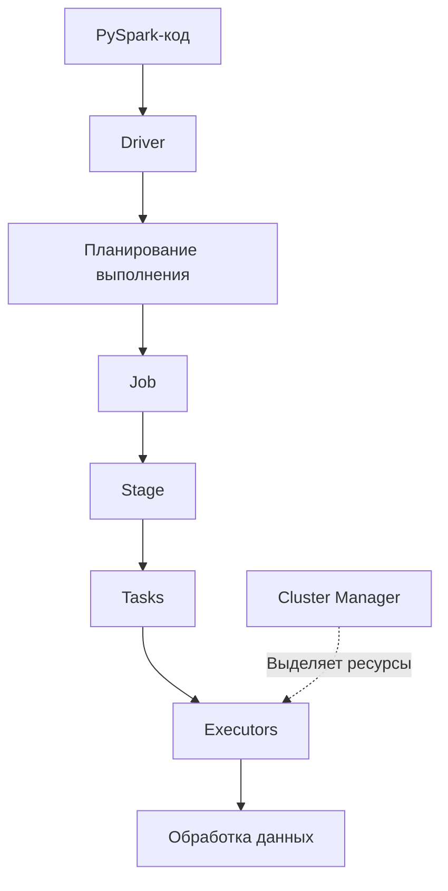
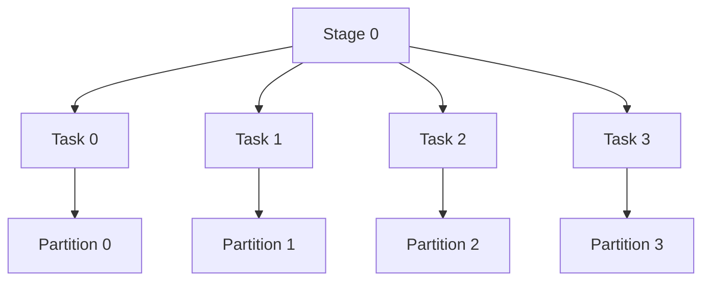
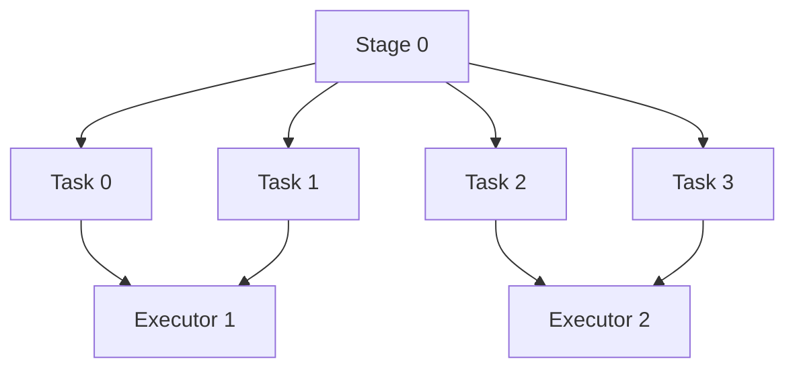

**1. Какие вкладки есть в Spark UI?**

<details>
<summary><strong>Ответ на вопрос</strong></summary>

**Spark UI** — веб-интерфейс для мониторинга выполнения Spark-приложения, анализа задач и поиска проблем с производительностью.

Основные вкладки:

| Вкладка | Назначение |
|---|---|
| **Jobs** | Показывает Spark Jobs, их статус, длительность и связанные стадии (Stages). |
| **Stages** | Детальная информация о стадиях: задачи (Tasks), время выполнения, shuffle, ошибки и распределение нагрузки. |
| **Storage** | Информация о RDD и DataFrame, сохранённых в памяти или на диске через `cache()` / `persist()`. |
| **Environment** | Конфигурация Spark-приложения, системные свойства и используемые библиотеки. |
| **Executors** | Информация об executor'ах: использование памяти, объём обработанных данных, задачи, ошибки и время работы. |
| **SQL / DataFrame** | Информация о SQL-запросах и DataFrame-операциях: физический план выполнения, стадии и метрики. |

Вкладка **SQL** отображается, когда приложение выполняет операции через Spark SQL или DataFrame API. Набор вкладок и доступные метрики зависят от версии Spark и конфигурации.

### Что важно понимать на собеседовании

- **Jobs** — смотрим, какие задания выполняются и сколько времени занимают.
- **Stages** — ищем медленные стадии и проблемы с shuffle.
- **Executors** — анализируем нагрузку, память и распределение задач между исполнителями.
- **Storage** — проверяем, какие данные закэшированы.
- **Environment** — проверяем настройки Spark.
- **SQL** — изучаем план выполнения запросов и метрики операций.

</details>

**2. Что такое Job, Stage, Task?**

<details>
<summary><strong>Ответ на вопрос</strong></summary>


# Spark Jobs, Stages и Tasks

## 1. Общая идея

Когда Spark выполняет обработку данных, он разбивает вычисления на задания и более мелкие части.

Есть три основных понятия:

- **Job** — вычислительное задание целиком.
- **Stage** — этап выполнения Job.
- **Task** — отдельная часть работы внутри Stage, обычно обрабатывающая одну партицию данных.

Связь между ними:

```text
Job — всё вычислительное задание
 ├── Stage 1 — первый этап
 │    ├── Task 1 — обработка партиции
 │    ├── Task 2 — обработка партиции
 │    └── Task 3 — обработка партиции
 │
 └── Stage 2 — второй этап
      ├── Task 1 — обработка партиции
      ├── Task 2 — обработка партиции
      └── Task 3 — обработка партиции
```

Это условная схема. В реальном приложении количество Stage и Task зависит от плана выполнения, партиций данных и операций.

## 2. Пример

Представим, что у нас есть таблица с 10 миллионами сотрудников. Нужно вычислить среднюю зарплату по каждой должности.

```python
df.groupBy("role").agg(
    avg("salary").alias("avg_salary")
).show()
```

Spark должен выполнить несколько действий:

1. Обработать исходные данные.
2. Сгруппировать данные по должностям.
3. Рассчитать среднюю зарплату.
4. Вернуть результат.

Spark организует выполнение этой работы.

### Job — что нужно сделать?

Job — вычислительное задание, которое Spark запускает, когда действие (action) требует вычислений.

В нашем примере цель — получить среднюю зарплату по должностям.

### Stage — на какие этапы разделена работа?

Stage — часть Job.

Spark разделяет Job на Stages с учётом зависимостей между операциями. Например, при группировке может потребоваться `shuffle` — обмен данными между партициями, чтобы собрать записи с одинаковыми должностями.

Shuffle часто приводит к границе между Stages.

### Task — кто обрабатывает отдельные части данных?

Task — единица работы внутри Stage. Обычно одна Task обрабатывает одну партицию данных.

Если Stage содержит четыре партиции, для его выполнения обычно потребуется четыре Tasks.

Несколько Tasks могут выполняться параллельно, если есть доступные ресурсы.

## 3. Что такое партиция?

**Партиция — часть данных, на которую Spark разделяет DataFrame для обработки.**

Например, таблица из 12 миллионов строк может быть разделена на 4 партиции по 3 миллиона строк.

Условная схема:

```text
DataFrame: 12 миллионов строк
          |
          v
  ┌───────┬───────┬───────┬───────┐
  │ Part 1│ Part 2│ Part 3│ Part 4│
  │ 3 млн │ 3 млн │ 3 млн │ 3 млн │
  └───────┴───────┴───────┴───────┘
```

Если Stage обрабатывает все четыре партиции, Spark обычно создаёт четыре Tasks — по одной на партицию.

Количество партиций не обязательно равно количеству Worker или Executor.

## 4. Где выполняются Tasks?

Tasks выполняются на Executor.

- **Master** управляет ресурсами кластера.
- **Worker** предоставляет вычислительные ресурсы.
- **Driver** управляет выполнением приложения.
- **Executor** выполняет Tasks.

Например, один Worker может запустить несколько Tasks на своих Executor, если хватает доступных ресурсов.

## 5. Как Job, Stage и Task связаны между собой?

| Термин | Что означает | Пример |
|---|---|---|
| Job | Всё вычислительное задание | Получить среднюю зарплату по должностям |
| Stage | Этап выполнения Job | Обработка данных до или после shuffle |
| Task | Часть работы внутри Stage | Обработка одной партиции |

## 6. Почему Spark создаёт Jobs?

Многие операции PySpark являются преобразованиями (transformations). Они описывают, как нужно обработать данные.

Например:

```python
filtered_df = df.filter(col("salary") > 90)
```

Само преобразование обычно не запускает вычисление результата.

Когда вызывается действие:

```python
filtered_df.show()
```

Spark запускает необходимые вычисления. Это может привести к созданию одного или нескольких Jobs.

Другие примеры действий:
- `show()`
- `count()`
- `collect()`
- `write...`

Количество Jobs не обязательно совпадает с количеством строк кода: Spark может запускать дополнительные Jobs в зависимости от операции и плана выполнения.

## 7. Где посмотреть Jobs, Stages и Tasks?

Открой Spark Application UI:

http://localhost:4040

Основные разделы:

- **Jobs** — список заданий приложения.
- **Stages** — этапы выполнения заданий.
- **Tasks** — отдельные части работы внутри Stage; их можно посмотреть в деталях соответствующего Stage.
- **Executors** — информация об исполнителях и используемых ресурсах.

Application UI обычно доступен, пока приложение работает.

## 8. Главное, что нужно запомнить

1. **Job** — вычислительное задание целиком.
2. **Stage** — этап выполнения Job.
3. **Task** — отдельная часть работы внутри Stage, обычно над одной партицией.
4. Spark может выполнять Tasks параллельно.
5. Shuffle часто разделяет выполнение на разные Stages.
6. Tasks выполняются на Executor, а Driver управляет выполнением приложения.
7. Количество Jobs, Stages и Tasks зависит от операций и плана выполнения Spark.


</details>


**3. Как Spark разбивает на партиции?**

<details>
<summary><strong>Ответ на вопрос</strong></summary>

# Apache Spark — партиции (Partitions)

## 1. Что такое партиция?

**Партиция (Partition)** — это логическая часть данных, которую Spark обрабатывает независимо от других частей.

Партиции позволяют распределять вычисления между executors и выполнять задачи параллельно.

Важно различать:
- **Partition** — часть данных.
- **Task** — задача, обрабатывающая одну партицию на конкретной стадии (`Stage`).
- **Executor** — процесс, выполняющий задачи.
- **CPU core** — вычислительный ресурс, позволяющий выполнять задачи параллельно.
- **Driver** — планирует вычисления и координирует работу приложения.

## 2. Как Spark формирует партиции?

При чтении данных Spark формирует входные партиции автоматически. Их количество зависит от:
- размера и количества файлов;
- формата данных и возможности разделить файл на части;
- настроек Spark;
- особенностей источника данных.

Например:

```python
df = spark.read.parquet("/data/salaries")

# Количество партиций
print(df.rdd.getNumPartitions())
```

Один большой файл может быть прочитан несколькими партициями, а несколько маленьких файлов могут объединяться в одну партицию.

**Количество партиций не определяется автоматически количеством CPU-ядер.** Число ядер влияет на количество задач, которые могут выполняться одновременно, а число партиций определяет, сколько частей данных предстоит обработать.

## 3. Как связаны Partitions, Tasks и Executors?

Допустим:
- создано 8 партиций;
- запущены 2 executors;
- каждому executor выделено по 2 CPU-ядра для задач Spark.

```text
                  Driver
                    |
              8 Tasks на Stage
                    |
          +---------+---------+
          |                   |
          v                   v
     Executor 1           Executor 2
     2 CPU cores          2 CPU cores
          |                   |
     Task 0, Task 1      Task 2, Task 3
          |                   |
          +---------+---------+
                    |
           4 Tasks одновременно

           После завершения:
     Executor 1           Executor 2
     Task 4, Task 5      Task 6, Task 7
```

В этом примере одновременно выполняются до четырёх задач, если ресурсы доступны и планировщик может их запустить.

На обычной стадии количество задач, как правило, соответствует количеству партиций, которые эта стадия обрабатывает. Между стадиями число и распределение партиций могут меняться.

## 4. Как изменить количество партиций?

### `repartition(n)`

```python
df2 = df.repartition(4)
```

Перераспределяет данные в 4 партиции, обычно с использованием `Shuffle`.

`Shuffle` — это перераспределение данных между партициями, которое может включать передачу данных по сети и запись промежуточных файлов.

### `coalesce(n)`

```python
df2 = df.coalesce(2)
```

Обычно уменьшает число партиций без полного shuffle. Распределение данных может быть неравномерным.

| Операция | Назначение |
|---|---|
| `repartition(n)` | Перераспределить данные в `n` партиций |
| `coalesce(n)` | Обычно уменьшить число партиций с меньшими затратами |
| `getNumPartitions()` | Получить количество партиций RDD |

## 5. Что происходит при `groupBy()`?

```python
from pyspark.sql.functions import avg

result = df.groupBy("role").agg(
    avg("salary").alias("avg_salary")
)

result.show()
```

При группировке Spark обычно выполняет `Shuffle`, чтобы собрать данные с одинаковым значением `role` для вычисления агрегатов.

```text
Исходные партиции
       |
       v
     Shuffle
       |
       v
Новые партиции по ключу role
       |
       v
Вычисление агрегатов
```

Важно:
- Spark не создаёт отдельную партицию для каждой группы.
- Одна партиция может содержать несколько разных групп.
- Строки с одинаковым ключом группировки должны попасть в одну логическую группу для итоговой агрегации.

Количество выходных shuffle-партиций в Spark SQL обычно задаётся настройкой:

```python
spark.conf.get("spark.sql.shuffle.partitions")
```

Стандартное значение по умолчанию — `200`. При включённом AQE (*Adaptive Query Execution*) Spark может корректировать число shuffle-партиций во время выполнения.

## 6. Партиции и параллелизм

Партиции определяют, на какие части разбивается работа. Tasks обрабатывают эти части, а executors выполняют Tasks на доступных ресурсах.

- Слишком мало партиций может ограничить параллелизм.
- Слишком много мелких партиций увеличивает накладные расходы на задачи.
- Неравномерное распределение данных может привести к тому, что отдельные задачи будут выполняться значительно дольше остальных.

Цель — подобрать подходящее количество партиций под объём данных, характер вычислений и доступные ресурсы.

## 7. `partitionBy()` — это не то же самое, что партиции Spark

При записи данных можно использовать:

```python
df.write.partitionBy("dt").parquet("/data/output")
```

`write.partitionBy("dt")` раскладывает файлы по каталогам на основе значений столбца `dt`.

Например:

```text
/data/output/
├── dt=2026-10-16/
├── dt=2026-10-17/
└── dt=2026-10-18/
```

Здесь нужно различать два механизма:

- **Вычислительные партиции Spark** — части данных, которые обрабатываются задачами.
- **`write.partitionBy()`** — организация файлов по значениям столбцов.

Количество каталогов при записи определяется встречающимися значениями или комбинациями значений указанных столбцов, а не количеством вычислительных партиций. При этом число файлов внутри каталогов зависит от распределения данных по задачам записи.

## Главное

Партиции определяют, как Spark делит данные для обработки. Они влияют на параллелизм, объём shuffle, накладные расходы и производительность заданий.

При этом количество партиций, количество executors, число CPU-ядер и количество каталогов при записи — разные понятия.


</details>

**4. Как работает shufle?**

<details>
<summary><strong>Ответ на вопрос</strong></summary>

# Apache Spark — Shuffle

**Shuffle в Apache Spark** — это процесс перераспределения данных между узлами кластера, который происходит тогда, когда операция требует собрать строки с одинаковым ключом в одном разделе (`partition`). 

Когда Spark выполняет действия вроде `groupBy`, `join`, `reduceByKey`, `distinct`, `orderBy` или `repartition`, он вынужден передавать данные по сети между `executors`, записывать временные файлы на диск, сортировать ключи и загружать их обратно на нужные узлы, чтобы продолжить вычисления. Из-за сетевого обмена, дисковой активности и сортировки `shuffle` считается самым медленным и «дорогим» этапом выполнения задач `Spark`, потому что он увеличивает задержку, потребляет много ресурсов и часто становится узким местом производительности. 

Например, если выполнить операцию `df.groupBy("department").agg({"salary": "avg"})`, Spark сначала локально сгруппирует данные по ключу `department` на каждом узле, затем на этапе `shuffle` отправит части данных с одинаковыми ключами на одни и те же узлы по хэшу ключа, а после этого на принимающих узлах выполнит финальную агрегацию. Именно эта необходимость физически перетасовать данные между узлами и делает `shuffle` таким тяжёлым, но при этом неизбежным механизмом в Spark.

Допустим, исходные данные находятся в двух партициях:

| Partition 0 | Partition 1 |
|---|---|
| Dev: 100 | QA: 90 |
| QA: 80 | Dev: 120 |
| Dev: 110 | QA: 70 |

Выполняем группировку:

```python
df.groupBy("role").agg(
    avg("salary").alias("avg_salary")
)
```

После Shuffle данные распределяются по ключу `role`:

| Partition A | Partition B |
|---|---|
| Dev: 100, 120, 110 | QA: 80, 90, 70 |

## Главное

- Одинаковые ключи направляются в одну выходную shuffle-партицию.
- Разные ключи могут попасть в одну партицию.
- Shuffle может передавать данные по сети и записывать промежуточные данные на диск.
- Количество выходных партиций зависит от настроек Spark и плана выполнения.
- Shuffle обычно возникает при `groupBy()`, `distinct()`, `repartition()` и некоторых `join()`.

</details>


**5. Как происходит выполнение задачи в PySpark**

<details>
<summary><strong>Ответ на вопрос</strong></summary>

Что происходит при запуске Spark-приложения на кластере. Когда в распоряжении Spark находится несколько узлов, или серверов, которые можно использовать для распределённых вычислений, большую задачу можно разбить между этими узлами. Так можно быстрее получить результат расчётов.

Итак, чтобы взаимодействовать со Spark, нужно в первую очередь создать (инициализировать) Spark-приложение с помощью Spark-сессии.

**Spark-сессия** — это точка входа в Spark-приложение. Объект, в котором определяются параметры конфигурации: название приложения, менеджер ресурсов (то есть способ подключения — локально, к Kubernetes, YARN или Mesos), количество выделяемых ядер и памяти.

Инициализированное Spark-приложение состоит из двух типов программ, или сущностей: **драйвер (от англ. driver — «двигатель»)** и **исполнитель (англ. executor)**. Драйвер — главная программа, в которой содержится написанный код. Исполнителей может быть несколько: они находятся в разных узлах и отвечают за вычисления.

Драйвер создаёт план вычислений и разбивает его на этапы (англ. job — «задание»). Разработчики их часто называют «джоба». В этапах выделяются стадии, а в них — задачи поменьше. Драйвер назначает задачи программам-исполнителям. Чем больше исполнителей, тем быстрее завершится работа над задачей.


</details>

# Apache Spark — архитектура и выполнение задач

## 1. Общая архитектура

Spark распределяет обработку больших объёмов данных между исполнителями (**Executors**).



### Основные компоненты

| Компонент | Что делает |
|---|---|
| **Driver** | Управляет приложением, строит план вычислений и распределяет задачи. |
| **Cluster Manager** | Выделяет ресурсы и запускает Executors. |
| **Executor** | Выполняет задачи над данными и использует выделенные CPU и память. |

**Важно:** Job, Stage и Task — это уровни организации вычислений. Executor — процесс, который выполняет Tasks.

## 2. Job, Stage, Task и Partition

### Job — вычисление

Job обычно запускается, когда вызывается действие (**Action**), например `show()`, `count()` или `write`.

### Stage — этап вычисления

Job делится на Stages. Обычно новый Stage появляется на границе Shuffle — когда данные нужно перераспределить между партициями.

### Task — задача

Task — единица работы, которую выполняет Executor. В рамках одного Stage обычно создаётся одна Task на каждую обрабатываемую Partition.

### Partition — часть данных

Partition — логическая часть набора данных. Spark обрабатывает разные партиции независимо, что позволяет выполнять работу параллельно.

## 3. Как связаны Task и Partition?

Представим, что данные разделены на 4 партиции.



**Запомни: одна Partition обычно обрабатывается одной Task в рамках одного Stage.**

Partition — это данные, а Task — работа над этими данными.

Если доступно 4 CPU-слота, Spark может выполнять 4 Tasks одновременно. Если доступно только 2 слота, задачи будут выполняться несколькими волнами.

## 4. Где выполняются Tasks?

Допустим, у нас 4 Tasks и 2 Executors.



Executor может выполнять несколько Tasks, но количество одновременно выполняемых задач ограничено доступными CPU-слотами.

## 5. Пример на PySpark

```python
df = spark.read.parquet("employees.parquet")

result = (
    df.groupBy("department")
      .avg("salary")
)

result.show()
```

Что происходит:

1. `spark.read.parquet()` описывает чтение данных.
2. `filter()`, `groupBy()` и другие трансформации формируют план обработки.
3. `show()` запускает вычисление, необходимое для отображения результата.
4. Spark формирует Job и разбивает его на Stages.
5. Каждый Stage выполняется набором Tasks.
6. Tasks обрабатывают партиции на Executors.
7. При `groupBy()` обычно происходит Shuffle — перераспределение данных по отделам.
8. Spark завершает вычисления и выводит результат.

## 6. Как запомнить иерархию

```text
Spark Application
└── Job
    ├── Stage 0
    │   ├── Task 0 → Partition 0
    │   ├── Task 1 → Partition 1
    │   └── Task 2 → Partition 2
    │
    └── Stage 1
        ├── Task 0 → Partition 0
        └── Task 1 → Partition 1
```

- **Application** — приложение Spark.
- **Job** — вычисление, запускаемое действием.
- **Stage** — этап Job.
- **Task** — работа над одной партицией на конкретном этапе.
- **Partition** — часть данных.
- **Executor** — процесс, выполняющий Tasks.

Количество партиций может измениться между Stages, например после Shuffle. Поэтому количество Tasks тоже может различаться.

**Главное:** Driver планирует работу, Cluster Manager выделяет ресурсы, а Executors выполняют Tasks над Partition.
